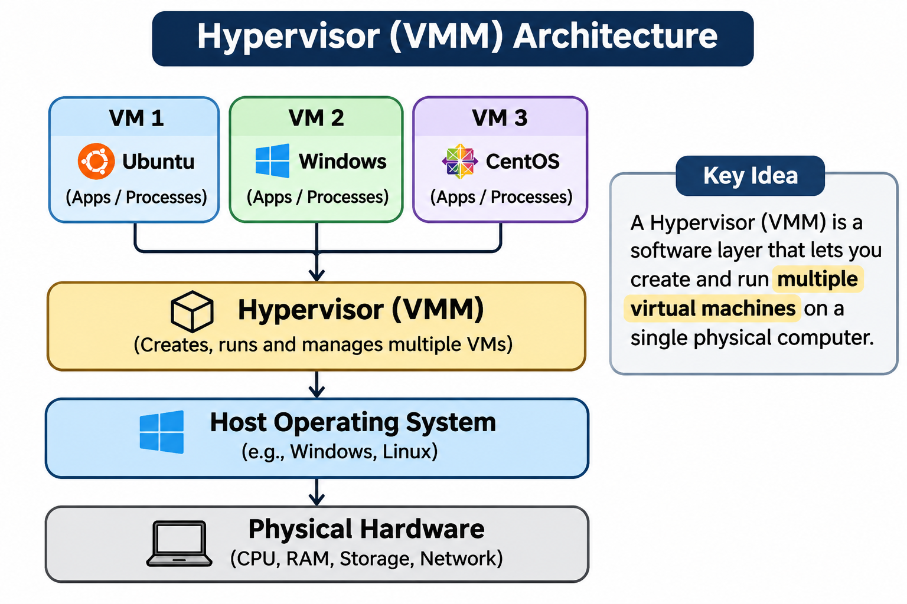

# Virtualization

Virtualization is the creation of a virtual version of hardware, allowing multiple operating systems to run on a single physical machine.

## Types of virtualization
#### 1. Server Virtualization

- Divides one physical server into multiple virtual servers (Virtual Machines or VMs).
- Each VM can run its own operating system and applications.
- **Examples:** VMware ESXi, Microsoft Hyper-V.

#### 2. Storage Virtualization

- Combines multiple physical storage devices into a single logical storage pool.
- Makes storage easier to manage and allocate.
- **Examples:** RAID, SAN virtualization.

#### 3. Network Virtualization

- Creates virtual networks, switches and routers independent of the underlying physical network.
- Helps manage and isolate network resources.
- **Examples:** VLAN, VMware NSX.

#### 4. Desktop Virtualization

- Allows users to access a virtual desktop environment hosted on a remote server.
- The desktop can be accessed from different devices over a network.
- **Examples:** VMware Horizon, Citrix Virtual Apps and Desktops.

#### 5. Application Virtualization

- Runs applications in an isolated virtual environment.
- Reduces the need to install applications traditionally and directly into the host operating system.
- **Example:** Microsoft App-V.

#### 6. Data Virtualization

- Provides a unified view of data from multiple sources.
- Allows users or applications to access data without necessarily moving it physically.
- **Example:** Denodo.

### Architecture of virtualization
Type 2 Hypervisor

### Main types of Hypervisor :
- Type 1 (Bare-Metal): Installed directly on physical hardware with host OS
- Type 2 (Hosted): Installed on top of existing host operating system

# Cloud
A platform that provide services over the internet, services such as networking, security, storage etc.

**Cloud services models:**

|Parameter|On-Premises|IaaS|PaaS|SaaS|
|-|-|-|-|-|
|Full Form|On-Premises|Infrastructure as a Service|Platform as a Service|Software as a Service|
|Meaning	|Organization owns and manages its IT infrastructure.|Provides virtualized infrastructure over the internet.|Provides a platform to develop and deploy applications.|Provides ready-to-use software over the internet.|
|Hardware|Managed by organization|Managed by provider|Managed by provider|Managed by provider|
|Networking|	Managed by organization|Managed by provider|Managed by provider|Managed by provider|
|Storage	|Managed by organization|Managed by provider|Managed by provider	|Managed by provider|
|Operating System|Managed by organization|Managed by user|Managed by provider|Managed by provider|
|Runtime	|Managed by organization	Managed by user	Managed by provider	Managed by provider|
|Applications|	Managed by organization	Managed by user	Managed by user	Managed by provider|
|Data|Managed by organization|Managed by user|Managed by user|Managed by user (responsibility for data remains with customer)|
|Maintenance|Organization|Shared responsibility|Mostly provider|Mostly provider|
|Control	|Maximum|High|Moderate|Least|
|Cost|High initial investment|Pay-as-you-go|Pay-as-you-go|Subscription-based|
|Example|Company's own data centre|AWS EC2|Google App Engine|Gmail, Google Docs|
