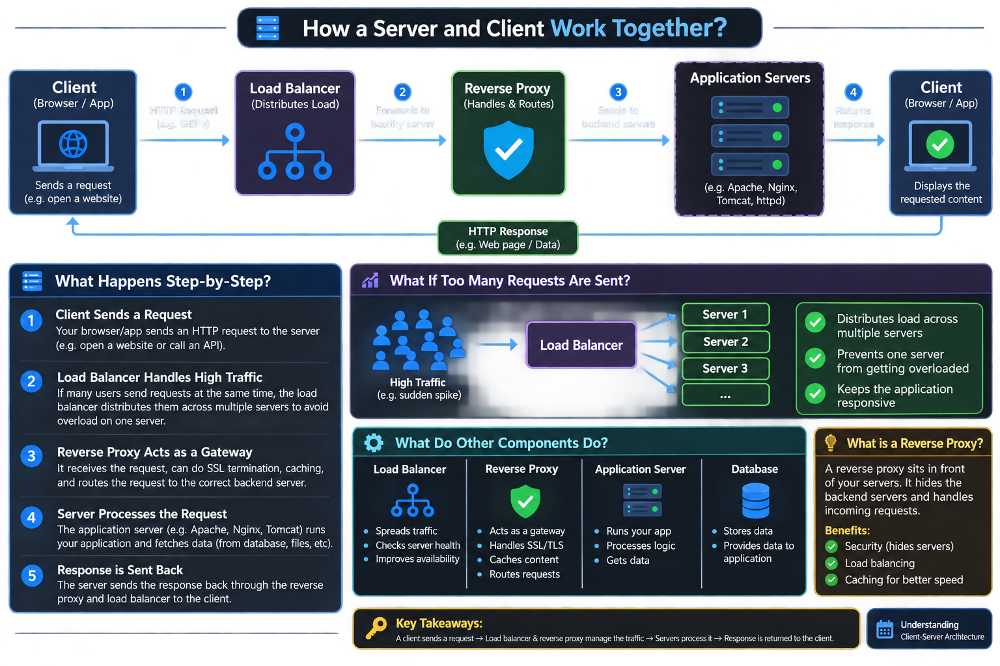

# Linux Server Setup: SSH, Apache, Nginx & Reverse Proxy

## 1. SSH Configuration on Ubuntu

**Goal:** Understand the SSH server settings that control root login and password authentication.

### Step 1: Open the SSH configuration directory

```bash
cd /etc/ssh/
```

### Step 2: Edit the main SSH configuration

```bash
sudo nano /etc/ssh/sshd_config
```

Find or add these settings:

```text
PermitRootLogin yes
PasswordAuthentication yes
```

Remove the `#` at the beginning if the settings are commented out.

### Step 3: Check the SSH drop-in configuration

```bash
cd /etc/ssh/sshd_config.d/
ls
```

A file may be named `60-cloudimg-settings.conf` or have a different name.

Open the relevant file:

```bash
sudo nano 60-cloudimg-settings.conf
```

Set:

```text
PasswordAuthentication yes
```

If a different cloud-init configuration file exists, inspect that file instead. SSH configuration drop-ins can override or affect settings in the main file.

### Step 4: Validate and restart SSH

Keep your current SSH session open while testing.

```bash
sudo sshd -t
```

No output generally means the syntax check passed.

Check the effective settings:

```bash
sudo sshd -T | grep -E 'permitrootlogin|passwordauthentication'
```

Restart SSH:

```bash
sudo systemctl restart ssh
```

On some distributions, the service may also be addressed as `sshd`:

```bash
sudo systemctl restart sshd
```

### Important security note

The settings `PermitRootLogin yes` and `PasswordAuthentication yes` allow direct root login and password-based SSH authentication.

**Do not expose this configuration to the public internet for production use.**

Safer configuration:

```text
PermitRootLogin no
PasswordAuthentication no
PubkeyAuthentication yes
```

Use a normal user with `sudo` privileges and SSH key authentication. If password login is required temporarily for a lab, restrict SSH access in the cloud Security Group to your own IP address (TCP port 22), use a strong password, and revert the setting afterwards.

Never close your working SSH session until a second login has been tested successfully.

---

## 2. Web Servers / Application Servers

| Name | Purpose |
|---|---|
| **Nginx** | Web server, reverse proxy and load balancer |
| **Apache HTTP Server** | Web server; package/service name is `httpd` on Amazon Linux and `apache2` on Ubuntu |
| **Tomcat** | Java application server / Servlet container; runs Java web applications |

### What is a Reverse Proxy?

A **reverse proxy** receives requests from clients and forwards them to backend application servers.

It can also handle:
- SSL/TLS termination
- Load balancing
- Caching
- Request routing

Example:

```text
Client / Browser
       |
       v
  Nginx (Reverse Proxy)
       |
       v
 Backend Application
 (Node.js / Tomcat / Python)
```

---

## 3. Identify Your Linux Distribution

Before installing packages, check the operating system:

```bash
cat /etc/os-release
```

This guide covers:

- Amazon Linux 2023
- Ubuntu 26.04 LTS / 26.10

Package managers:

| Operating System | Package Manager |
|---|---|
| Amazon Linux 2023 | `dnf` |
| Ubuntu | `apt` |

---

## 4. Install Apache HTTP Server on Amazon Linux 2023

On Amazon Linux, Apache's package and service name is `httpd`.

### Step 1: Update packages

```bash
sudo dnf update -y
```

### Step 2: Install Apache

```bash
sudo dnf install httpd -y
```

### Step 3: Start and enable Apache

```bash
sudo systemctl enable --now httpd
```

### Step 4: Verify

```bash
sudo systemctl status httpd
httpd -v
```

Look for `active (running)` in the service status.

### Apache file locations on Amazon Linux

| Purpose | Location |
|---|---|
| Main configuration | `/etc/httpd/conf/httpd.conf` |
| Additional configurations | `/etc/httpd/conf.d/` |
| Website files (Document Root) | `/var/www/html/` |
| Access logs | `/var/log/httpd/access_log` |
| Error logs | `/var/log/httpd/error_log` |

**Where to put website code?**

Place your website files inside:

```bash
/var/www/html/
```

Example:

```text
/var/www/html/
    index.html
    style.css
    script.js
    images/
```

Create a test page:

```bash
echo "<h1>Hello from Apache on Amazon Linux!</h1>" | sudo tee /var/www/html/index.html
```

---

## 5. Install Nginx on Amazon Linux 2023

### Step 1: Update packages

```bash
sudo dnf update -y
```

### Step 2: Install Nginx

```bash
sudo dnf install nginx -y
```

### Step 3: Start and enable Nginx

```bash
sudo systemctl enable --now nginx
```

### Step 4: Verify

```bash
sudo systemctl status nginx
nginx -v
```

### Nginx file locations on Amazon Linux

| Purpose | Location |
|---|---|
| Main configuration | `/etc/nginx/nginx.conf` |
| Additional configurations | `/etc/nginx/conf.d/` |
| Default website files | `/usr/share/nginx/html/` |
| Access logs | `/var/log/nginx/access.log` |
| Error logs | `/var/log/nginx/error.log` |

**Where to put website code?**

For the default Nginx website, place your files inside:

```bash
/usr/share/nginx/html/
```

Example:

```text
/usr/share/nginx/html/
    index.html
    style.css
    script.js
    images/
```

Create a test page:

```bash
echo "<h1>Hello from Nginx on Amazon Linux!</h1>" | sudo tee /usr/share/nginx/html/index.html
```

---

## 6. Install Apache (`apache2`) on Ubuntu

### Step 1: Update package lists

```bash
sudo apt update
```

### Step 2: Install Apache

```bash
sudo apt install apache2 -y
```

### Step 3: Start and enable Apache

```bash
sudo systemctl enable --now apache2
```

### Step 4: Verify

```bash
sudo systemctl status apache2
apache2 -v
```

### Apache file locations on Ubuntu

| Purpose | Location |
|---|---|
| Main configuration | `/etc/apache2/apache2.conf` |
| Ports configuration | `/etc/apache2/ports.conf` |
| Virtual host configurations | `/etc/apache2/sites-available/` |
| Enabled websites | `/etc/apache2/sites-enabled/` |
| Website files (Document Root) | `/var/www/html/` |
| Access logs | `/var/log/apache2/access.log` |
| Error logs | `/var/log/apache2/error.log` |

**Where to put website code?**

Place your website files inside:

```bash
/var/www/html/
```

Example:

```text
/var/www/html/
    index.html
    style.css
    script.js
    images/
```

Create a test page:

```bash
echo "<h1>Hello from Apache on Ubuntu!</h1>" | sudo tee /var/www/html/index.html
```

---

## 7. Install Nginx on Ubuntu

### Step 1: Update package lists

```bash
sudo apt update
```

### Step 2: Install Nginx

```bash
sudo apt install nginx -y
```

### Step 3: Start and enable Nginx

```bash
sudo systemctl enable --now nginx
```

### Step 4: Verify

```bash
sudo systemctl status nginx
nginx -v
```

### Nginx file locations on Ubuntu

| Purpose | Location |
|---|---|
| Main configuration | `/etc/nginx/nginx.conf` |
| Additional configurations | `/etc/nginx/conf.d/` |
| Available website configurations | `/etc/nginx/sites-available/` |
| Enabled website configurations | `/etc/nginx/sites-enabled/` |
| Default website files | `/var/www/html/` |
| Access logs | `/var/log/nginx/access.log` |
| Error logs | `/var/log/nginx/error.log` |

**Where to put website code?**

For the default Nginx website, place your files inside:

```bash
/var/www/html/
```

Example:

```text
/var/www/html/
    index.html
    style.css
    script.js
    images/
```

Create a test page:

```bash
echo "<h1>Hello from Nginx on Ubuntu!</h1>" | sudo tee /var/www/html/index.html
```

---

## 8. Where Should We Put Our Website Code?

This is an important concept when deploying a website on a Linux server.

The directory where website files are stored and served from is called the **Document Root**.

### Default Document Root Locations

| Web Server | Operating System | Document Root |
|---|---|---|
| Apache (`httpd`) | Amazon Linux | `/var/www/html/` |
| Apache (`apache2`) | Ubuntu | `/var/www/html/` |
| Nginx | Amazon Linux | `/usr/share/nginx/html/` |
| Nginx | Ubuntu | `/var/www/html/` |

### Example: Deploying a Static Website

Suppose you have developed a website containing:

```text
MyWebsite/
    index.html
    about.html
    style.css
    script.js
    images/
```

You need to copy the website files into the server's Document Root.

For example, on Ubuntu:

```bash
sudo cp -r MyWebsite/. /var/www/html/
```

On Amazon Linux Nginx:

```bash
sudo cp -r MyWebsite/. /usr/share/nginx/html/
```

**Important:** Replace `MyWebsite` with the actual path to your website directory.

After copying the files, open your browser:

```text
http://YOUR_PUBLIC_IP
```

Your website should now be visible.

### Recommended production directory structure

For a custom website, you can also create a separate directory instead of using the default one:

```bash
sudo mkdir -p /var/www/mywebsite
```

Place your website files there:

```text
/var/www/mywebsite/
    index.html
    css/
    js/
    images/
```

You must then update the web server's virtual host or server block configuration to point to:

```text
/var/www/mywebsite
```

The server will not automatically serve this new directory until the configuration is updated.

---

## 9. Web Server Configuration Files

Configuration files tell the web server where website files are located and how requests should be handled.

### Apache on Amazon Linux

Main configuration:

```bash
sudo nano /etc/httpd/conf/httpd.conf
```

Additional website configurations:

```bash
cd /etc/httpd/conf.d/
```

### Apache on Ubuntu

Main configuration:

```bash
sudo nano /etc/apache2/apache2.conf
```

Website configurations:

```bash
cd /etc/apache2/sites-available/
```

Enable a website configuration:

```bash
sudo a2ensite mywebsite.conf
```

Disable it:

```bash
sudo a2dissite mywebsite.conf
```

### Nginx on Amazon Linux

Main configuration:

```bash
sudo nano /etc/nginx/nginx.conf
```

Additional configurations:

```bash
cd /etc/nginx/conf.d/
```

### Nginx on Ubuntu

Main configuration:

```bash
sudo nano /etc/nginx/nginx.conf
```

Available website configurations:

```bash
cd /etc/nginx/sites-available/
```

Enabled website configurations:

```bash
cd /etc/nginx/sites-enabled/
```

Enable a website configuration using a symbolic link:

```bash
sudo ln -s /etc/nginx/sites-available/mywebsite /etc/nginx/sites-enabled/
```

Test configuration before reloading:

```bash
sudo nginx -t
sudo systemctl reload nginx
```

---

## 10. `httpd` vs `apache2` — Remember This

| Operating System | Apache Package | Apache Service |
|---|---|---|
| Amazon Linux 2023 | `httpd` | `httpd` |
| Ubuntu | `apache2` | `apache2` |

`httpd` and `apache2` are names for the same Apache HTTP Server software on different Linux distributions.

On Ubuntu, install and manage `apache2`; do not try to install `httpd` as a separate web server.

---

## 11. Test the Web Server

### Step 1: Test locally from the instance

```bash
curl -I http://localhost
```

A successful response commonly includes:

```text
HTTP/1.1 200 OK
```

### Step 2: Allow HTTP in AWS

In the EC2 Security Group, add an inbound rule:

| Type | Protocol | Port | Source |
|---|---|---|---|
| HTTP | TCP | 80 | Your IP or an appropriate allowed range |

For a public website, `0.0.0.0/0` allows access from anywhere over IPv4. Use this only when the website is intended to be public.

Also check the instance firewall if one is enabled.

### Step 3: Open the website

Find the instance's Public IPv4 address and visit:

```text
http://YOUR_PUBLIC_IP
```

### Step 4: Check website logs

Apache on Amazon Linux:

```bash
sudo tail -f /var/log/httpd/access_log
```

Apache on Ubuntu:

```bash
sudo tail -f /var/log/apache2/access.log
```

Nginx:

```bash
sudo tail -f /var/log/nginx/access.log
```

Use `Ctrl + C` to stop following the logs.

---

## 12. Basic Service Commands

| Action | Amazon Linux Apache | Ubuntu Apache | Nginx (both) |
|---|---|---|---|
| Start | `sudo systemctl start httpd` | `sudo systemctl start apache2` | `sudo systemctl start nginx` |
| Stop | `sudo systemctl stop httpd` | `sudo systemctl stop apache2` | `sudo systemctl stop nginx` |
| Restart | `sudo systemctl restart httpd` | `sudo systemctl restart apache2` | `sudo systemctl restart nginx` |
| Enable at boot | `sudo systemctl enable httpd` | `sudo systemctl enable apache2` | `sudo systemctl enable nginx` |
| Status | `sudo systemctl status httpd` | `sudo systemctl status apache2` | `sudo systemctl status nginx` |

**Note:** Apache and Nginx commonly both listen on port 80 by default. Stop one before starting the other with the default configuration, or configure different ports / a reverse-proxy setup.

---

## 13. Troubleshooting Commands

Check which process is using port 80:

```bash
sudo ss -tulpn | grep ':80'
```

Test Nginx configuration:

```bash
sudo nginx -t
```

Test Apache configuration on Amazon Linux:

```bash
sudo httpd -t
```

Test Apache configuration on Ubuntu:

```bash
sudo apache2ctl configtest
```

View service logs:

```bash
sudo journalctl -u nginx
sudo journalctl -u httpd
sudo journalctl -u apache2
```

---

## 14. Quick Installation Revision

| Server | Amazon Linux 2023 | Ubuntu |
|---|---|---|
| Apache | `sudo dnf install httpd -y` | `sudo apt install apache2 -y` |
| Nginx | `sudo dnf install nginx -y` | `sudo apt install nginx -y` |

**Ports to remember:**

- SSH: TCP `22`
- HTTP: TCP `80`
- HTTPS: TCP `443`

---

## 15. Servers and Clients Work Together



---

## References

- [Amazon Linux 2023 Documentation](https://docs.aws.amazon.com/linux/al2023/ug/)
- [Ubuntu Server Documentation](https://ubuntu.com/server/docs/)
- [OpenSSH Documentation](https://man.openbsd.org/sshd_config)
- [Apache HTTP Server Documentation](https://httpd.apache.org/docs/2.4/)
- [Nginx Documentation](https://nginx.org/en/docs/)

---

**Dated: 20 November 2026**
