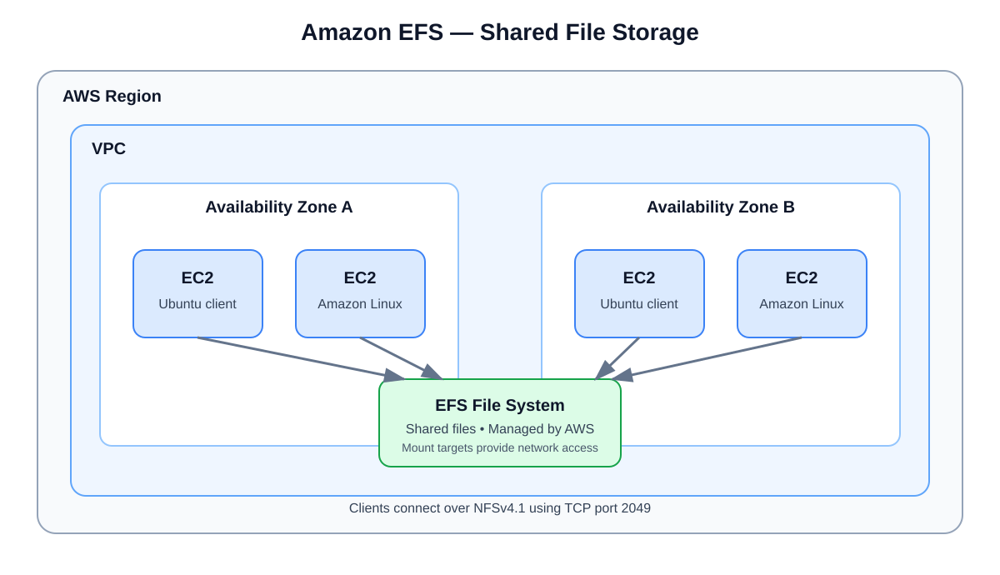
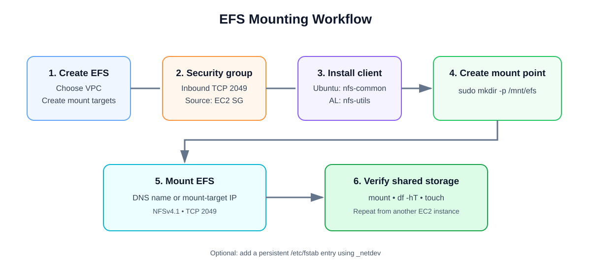

## 1. What is Amazon EFS?

Amazon Elastic File System (EFS) is a fully managed, elastic file storage service for Linux-based workloads. Multiple EC2 instances can mount the same EFS file system at the same time and access shared files.

- **Regional service:** A Regional EFS file system can have mount targets in multiple Availability Zones (AZs) within one AWS Region.
- **Shared access:** Multiple EC2 instances can access the same file system concurrently.
- **NFS:** EFS uses the Network File System (NFS) protocol. For EC2 Linux clients, EFS supports NFSv4.0 and NFSv4.1; NFSv4.1 is commonly used.
- **Managed storage:** AWS manages the EFS storage infrastructure and availability. We manage client instances, network access, permissions, and mount configuration.
- **Network access:** EC2 clients connect to an EFS mount target over the VPC network.
- **Port:** NFS traffic uses TCP port `2049`.

> **Correction to remember:** EFS is not “globally called NFS.” EFS is AWS's managed file-system service; NFS is the network file-sharing protocol it uses.

## 2. EFS architecture



- The EFS file system stores the shared data.
- A mount target provides a network endpoint in a subnet/AZ through which clients connect.
- Each EC2 instance mounts the file system at a local directory, such as `/mnt/efs`.
- A file created by one authorized client can be accessed by the other clients.

### Important terminology

| Term | Meaning |
|---|---|
| EFS file system | The shared file storage resource |
| Mount target | Network endpoint in a VPC subnet used by clients to connect to EFS |
| Mount point | Local directory on EC2 where EFS is attached, e.g. `/mnt/efs` |
| NFS | Network File System protocol used to access shared files |
| AZ | Availability Zone within an AWS Region |
| EFS security group | Virtual firewall attached to EFS mount targets |

## 3. EFS vs EBS

| Feature | EFS | EBS |
|---|---|---|
| Storage type | File storage | Block storage |
| Access | Shared by multiple Linux clients | Normally attached to one EC2 instance at a time (Multi-Attach is available for supported volume types/configurations) |
| Scope | Regional file system; mount targets in AZs | Volume is AZ-scoped |
| Access method | NFS over network | Block device attached to EC2 |
| Typical use | Shared files, content, application uploads | OS disk, databases, application data disk |
| Mounting | Mount at a directory | Format/partition if needed, then mount |

## 4. Before creating EFS — prerequisites

Make sure:

1. You have an AWS account and permission to create EFS, EC2, VPC and security-group resources.
2. Your EC2 instances are in the same VPC as the EFS mount targets for this basic exercise.
3. You know the AWS Region and VPC used by your EC2 instances.
4. The EC2 instance security group allows outbound TCP `2049` to the EFS mount-target security group.
5. The EFS mount-target security group allows inbound TCP `2049` from the EC2 instance security group.

### Required security-group rules

| Security group | Direction | Type / Protocol | Port | Source / Destination |
|---|---|---|---:|---|
| EC2 client SG | Outbound | TCP | 2049 | EFS mount-target SG |
| EFS mount-target SG | Inbound | TCP | 2049 | EC2 client SG |
| EC2 client SG | Inbound | SSH / TCP | 22 | Your trusted IP address (for administration) |

**Security note:** Do not open NFS port `2049` to `0.0.0.0/0`. Use the EC2 client security group as the source of the EFS inbound rule. The default outbound rule on the EC2 security group may already allow the required traffic; if outbound is restricted, add the specific rule shown above.

## 5. Create an EFS file system in AWS Console

1. Sign in to the **AWS Management Console**.
2. Search for and open **Elastic File System (EFS)**.
3. Select **Create file system**.
4. Enter a name, for example `shared-efs-lab`.
5. Select the **same VPC** used by your EC2 instances.
6. For a beginner lab, use the recommended **Regional** availability option.
7. Create the file system. Review the selected storage, encryption and throughput settings before confirming.
8. Open the created file system and wait until its lifecycle state is **Available**.
9. Open the **Network** tab and review the mount targets.
10. Confirm that mount targets exist in the Availability Zones/subnets where your EC2 clients will connect. For resilient Regional access, create a mount target in each AZ from which clients will access EFS.
11. Note the **File system ID**, for example `fs-xxxxxxxxxxxxxxxxx`.
12. Note the mount-target security group.

> A Regional EFS file system is regional, but clients access it through mount targets in a VPC. It is not automatically reachable from every VPC or every Region. Cross-VPC/cross-Region access requires additional network configuration.

## 6. Configure the EFS security group

1. Open **EC2 → Security Groups**.
2. Select the security group attached to the EFS mount targets.
3. Choose **Inbound rules → Edit inbound rules**.
4. Add a rule:
   - Type: `NFS`
   - Protocol: `TCP`
   - Port: `2049`
   - Source: **the security group attached to your EC2 client instances**
5. Save the rules.
6. Check the EC2 client security group's outbound rules. Allow TCP `2049` to the EFS mount-target security group if outbound traffic is restricted.

**Why?** The EC2 client initiates the NFS connection to the EFS mount target. The EFS security group must permit that inbound connection.

## 7. Install the NFS client

Connect to each EC2 instance using SSH.

### A. Ubuntu

Update package lists and install the NFS client utilities:

```bash
sudo apt update
sudo apt install -y nfs-common
```

Check that the NFS mount utility is available:

```bash
mount.nfs -V
```

### B. Amazon Linux 2023 / Amazon Linux 2

Install the NFS client utilities:

```bash
sudo dnf install -y nfs-utils
```

For Amazon Linux 2, `yum` is also commonly used:

```bash
sudo yum install -y nfs-utils
```

Check the utility:

```bash
mount.nfs -V
```

> **Package distinction:** `nfs-common` is the usual package name on Ubuntu/Debian. `nfs-utils` is used on Amazon Linux, RHEL and similar RPM-based distributions.

## 8. Create a mount point

Run this on every EC2 instance that needs shared access:

```bash
sudo mkdir -p /mnt/efs
```

`/mnt/efs` is the local directory where the EFS file system will appear.

Check the directory:

```bash
ls -ld /mnt/efs
```

## 9. Mount EFS using its DNS name

The EFS DNS name normally follows this pattern:

```text
<file-system-id>.efs.<region>.amazonaws.com
```

Example placeholders:

```text
fs-1234567890abcdef0.efs.ap-south-1.amazonaws.com
```

Replace the example file-system ID and Region with your actual values.

### A. Mount using the standard NFS client — Ubuntu and Amazon Linux

```bash
sudo mount -t nfs4 -o nfsvers=4.1 \
fs-1234567890abcdef0.efs.ap-south-1.amazonaws.com:/ \
/mnt/efs
```

One-line version:

```bash
sudo mount -t nfs4 -o nfsvers=4.1 fs-1234567890abcdef0.efs.ap-south-1.amazonaws.com:/ /mnt/efs
```

### B. Mount using the EFS mount helper (optional, recommended by AWS)

The EFS mount helper is included in the `amazon-efs-utils` package. On Amazon Linux 2 / 2023, install it using:

```bash
sudo yum install -y amazon-efs-utils
```

For Amazon Linux 2023, `dnf` can also be used:

```bash
sudo dnf install -y amazon-efs-utils
```

Then mount with TLS:

```bash
sudo mount -t efs -o tls fs-1234567890abcdef0:/ /mnt/efs
```

For Ubuntu, `nfs-common` provides the standard NFS client, but it does **not** install the AWS EFS mount helper. If you want the `-t efs` helper and TLS options on Ubuntu, install the compatible `amazon-efs-utils` DEB package using AWS's official installation instructions.

## 10. Mount EFS using the mount-target IP address

Use this method if DNS resolution is unavailable or you need to test using a specific mount target.

1. Open **EFS → File systems → your file system → Network**.
2. Find the mount target in the Availability Zone used by your EC2 instance.
3. Copy its IP address.
4. Use that mount-target IP in the NFS mount command.

Example:

```bash
sudo mount -t nfs4 -o nfsvers=4.1 10.0.1.25:/ /mnt/efs
```

`10.0.1.25` is only an example. Use the actual private IP address of your EFS mount target.

> Prefer the mount target in the same Availability Zone as the EC2 client where possible. Mount-target IP addresses are private VPC addresses; they are not public internet endpoints.

### DNS vs IP mounting

| Method | Example | When to use |
|---|---|---|
| DNS | `fs-xxxx.efs.ap-south-1.amazonaws.com:/` | Recommended for normal use; DNS resolves to a mount target |
| IP | `10.0.1.25:/` | Useful when DNS is unavailable or for a specific mount target |

For DNS mounting, the EC2 instance must be in the appropriate VPC DNS environment, and a mount target must be available in the relevant AZ. Allow time for mount-target DNS records to propagate after creation.

## 11. Verify that EFS is mounted

Run:

```bash
df -hT
```

Or:

```bash
mount | grep efs
```

You should see the EFS file system mounted at `/mnt/efs`.

Create a test file:

```bash
sudo touch /mnt/efs/test-file.txt
ls -l /mnt/efs
```

If you need to test as a normal user, remember that Linux ownership and permissions apply. For a simple lab, you can create a dedicated directory and grant access to a chosen user/group rather than making the entire file system world-writable.

## 12. Test shared access from multiple EC2 instances

Use two EC2 instances in the same VPC, and mount the same EFS file system on both.

### On EC2 Instance 1

```bash
echo "Hello from EC2 Instance 1" | sudo tee /mnt/efs/shared.txt
```

### On EC2 Instance 2

```bash
cat /mnt/efs/shared.txt
```

Expected output:

```text
Hello from EC2 Instance 1
```

Now create a file from Instance 2:

```bash
echo "Hello from EC2 Instance 2" | sudo tee /mnt/efs/instance2.txt
```

Check `/mnt/efs` on Instance 1. The new file should also be visible.

**Result:** Both EC2 instances are accessing the same shared EFS file system.

> EFS provides shared storage, not automatic application-level synchronization or conflict resolution. File permissions, ownership and concurrent-write behaviour still matter.

## 13. Permanent mounting using `/etc/fstab`

A manual mount may not remain mounted after a reboot. To mount EFS automatically at boot, configure `/etc/fstab`.

Back up the file first:

```bash
sudo cp /etc/fstab /etc/fstab.backup
```

Edit it:

```bash
sudo nano /etc/fstab
```

### Option A — Standard NFS client using DNS

Add one line, replacing the file-system DNS name:

```fstab
fs-1234567890abcdef0.efs.ap-south-1.amazonaws.com:/ /mnt/efs nfs4 defaults,_netdev,nfsvers=4.1 0 0
```

### Option B — EFS mount helper

If `amazon-efs-utils` is installed, use:

```fstab
fs-1234567890abcdef0:/ /mnt/efs efs _netdev,tls 0 0
```

### Test the configuration before rebooting

```bash
sudo umount /mnt/efs
sudo mount -a
df -hT
```

If there are no errors and EFS appears mounted, the entry is working.

**Important:** `_netdev` tells Linux that this is a network filesystem and helps ensure networking is available before mounting. Do not omit it from an automatic EFS mount entry.

## 14. Useful troubleshooting commands

| Command | Purpose |
|---|---|
| `lsblk` | List block devices (EFS is a network file system, so it may not appear as a normal block disk) |
| `df -hT` | Check mounted filesystems and types |
| `mount \| grep efs` | Check EFS mount details |
| `showmount -e <host>` | Query NFS exports where supported; not required for EFS mounting |
| `getent hosts <efs-dns-name>` | Check DNS resolution |
| `nc -zv <mount-target-ip> 2049` | Test TCP connectivity to NFS port |
| `sudo umount /mnt/efs` | Unmount EFS |
| `sudo mount -a` | Test `/etc/fstab` entries |

### Common problems

| Problem | Things to check |
|---|---|
| Connection timed out | EFS SG inbound TCP 2049, EC2 SG outbound TCP 2049, VPC/subnet routing |
| DNS name does not resolve | VPC DNS resolution/hostnames, correct Region and file-system ID, mount target availability |
| Mount command says helper missing | For `-t efs`, install `amazon-efs-utils`; for `-t nfs4`, install the OS NFS client |
| Permission denied | Linux UID/GID, directory permissions, EFS access point or file-system policy |
| Mount works manually but not after reboot | `/etc/fstab` syntax, `_netdev`, network readiness |
| Wrong IP used | Use the mount-target IP from the correct EFS file system and preferably the client's AZ |

## 15. Clean up AWS lab resources

To avoid unnecessary charges after practice:

1. Unmount EFS from all EC2 instances:

   ```bash
   sudo umount /mnt/efs
   ```

2. Remove the EFS `/etc/fstab` entry if you added one and no longer need it.
3. Delete the EFS file system from the EFS console if the lab is complete.
4. Terminate EC2 instances if you no longer need them.
5. Remove unused security groups only after checking that no other resources depend on them.

**Cost reminder:** EFS storage and related features can incur charges while the file system exists. EC2 instances, data transfer and other resources may also incur charges.

---

## EFS Mounting Workflow

The following diagram explains how an EC2 instance connects to EFS.



---

# Quick Revision

<details>
<summary><strong>1. What is EFS?</strong></summary>

- EFS = Elastic File System.
- Fully managed AWS file storage.
- Multiple EC2 instances can access the same file system.
- Uses NFS protocol.
- Regional EFS can have mount targets in multiple AZs.
- NFS uses TCP port `2049`.

</details>

<details>
<summary><strong>2. Important packages</strong></summary>

| Operating system | NFS client package |
|---|---|
| Ubuntu | `nfs-common` |
| Amazon Linux | `nfs-utils` |
| RHEL | `nfs-utils` |

Install:

```bash
# Ubuntu
sudo apt update
sudo apt install -y nfs-common

# Amazon Linux 2
sudo yum install -y nfs-utils

# Amazon Linux 2023
sudo dnf install -y nfs-utils
```

</details>

<details>
<summary><strong>3. Mounting commands</strong></summary>

```bash
# Create mount point
sudo mkdir -p /mnt/efs

# Mount using DNS
sudo mount -t nfs4 -o nfsvers=4.1 <efs-dns-name>:/ /mnt/efs

# Mount using IP
sudo mount -t nfs4 -o nfsvers=4.1 <mount-target-ip>:/ /mnt/efs

# Verify
df -hT
```

</details>

<details>
<summary><strong>4. Important networking details</strong></summary>

- Protocol: NFSv4.1
- Transport: TCP
- Port: `2049`
- EFS mount target inbound: allow TCP 2049 from EC2 client security group.
- EC2 outbound: allow TCP 2049 to EFS mount-target security group.
- Prefer a mount target in the client's AZ.

</details>

<details>
<summary><strong>5. Permanent mounting</strong></summary>

Standard NFS entry:

```fstab
<efs-dns-name>:/ /mnt/efs nfs4 defaults,_netdev,nfsvers=4.1 0 0
```

EFS mount helper entry:

```fstab
<fs-id>:/ /mnt/efs efs _netdev,tls 0 0
```

Test:

```bash
sudo mount -a
df -hT
```

</details>

<details>
<summary><strong>6. Important differences: EFS vs EBS</strong></summary>

- EFS = Shared file storage over the network.
- EBS = Block storage attached to EC2.
- EFS = Regional service with mount targets in AZs.
- EBS volume = AZ-scoped.
- EFS = NFS.
- EBS = Block device.

</details>

---

**Dated:** 27 November 2026