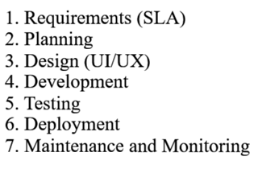

# What is Cloud?
Cloud is platform which provided services like storage, security, networking etc.

# What is an application?
- An application is basically a piece of code that is made to make day to day tasks more easy.
- An application consists of: front end ---> backend ---> database

# What is SDLC?
- SDLC or Software Development Life Cycle is basically the process involved in making of the application from scratch to production level.

- The phases of SDLC are:

SLA stands for Service Level Agreement

Dated: 12th October 2026
