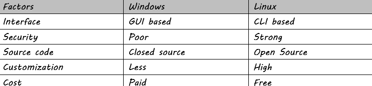

# Difference between windows and linux

# Operating System
- It is a system software
- An interface between hardware and software or the user
- Provides environment to run applications smoothly

# Why AWS?
- AWS provides 250+ services + integrations
- It has data centres all over the globe
- The offers Pay as you go facility

AWS came in 2004.

Dated: 13th October 2026
