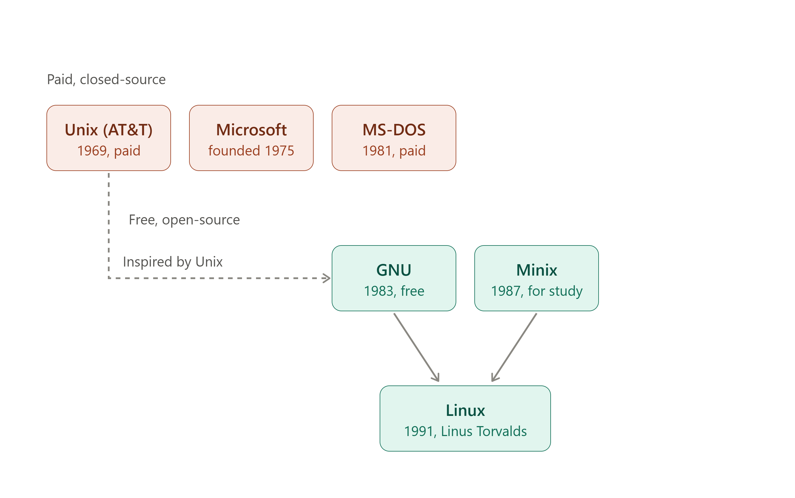
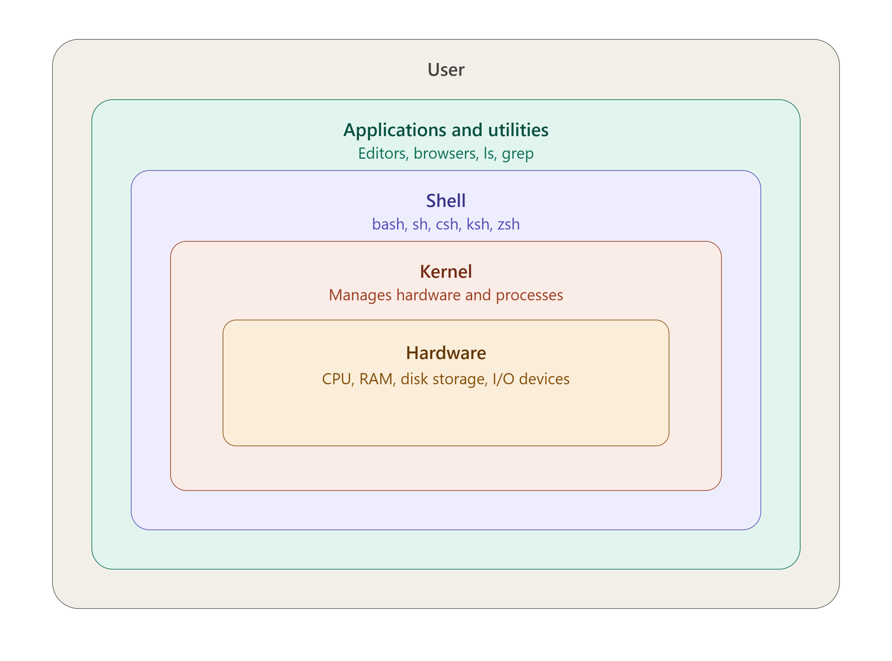

# Types of OS
- Single user OS
- Multiuser OS
- Realtime OS (RTOS)
- Mobile OS
- Server OS
- Desktop OS
- Embedded OS

# History of Linux

- Linux is a kernel

# Distributors of Linux
- Ubuntu
- Debian
- Linux Mint
- Kali linux
- Fedora
- Cent OS
- Arch
- Alpine
- SUSE : openSUSE etc

# Linux Architecture

- Hardware: The physical parts of the computer, like the CPU, RAM, disk, and input/output devices. It does the actual work but only understands low-level signals.
- Kernel: The core of Linux. It manages the hardware, runs processes, allocates memory, and controls access to devices. It’s the only layer that talks to the hardware directly.
- Shell: The command interpreter. It takes the commands you type, passes them to the kernel, and shows you the result. Common shells are bash, sh, csh, ksh, and zsh.
- Applications and utilities: The programs you actually use, such as text editors, browsers, and command-line tools like ls and grep. They run on top of the shell and kernel.
- User: You, the person giving instructions through the applications or the shell.

# Types of Kernel:
- Monolithic kernel: The whole operating system (process management, memory, file systems, device drivers) runs in one large block in kernel space. It’s fast, but a bug in one part can crash the whole system. Linux and traditional Unix use this design.
- Microkernel: Only the essentials (basic memory, process scheduling, communication between processes) stay in the kernel. Everything else, like drivers and file systems, runs as separate user-space services. It’s more stable and secure, but slower because of extra communication. Minix is an example.
- Hybrid kernel: A mix of both. It keeps a microkernel-like structure but runs more services inside the kernel for speed. Windows (NT kernel) and macOS (XNU) are examples.
- Exokernel (less common): A minimal kernel that only protects and allocates hardware, leaving applications to manage resources themselves. It’s mostly used in research.
- Nanokernel: An extremely small kernel that handles only basic hardware tasks like interrupts and timers, leaving everything else to higher layers. It’s lighter than a microkernel, but needs more software on top to be useful.

# General Commands
- whoami--> to check the username
- hostname --> to check the hostname
- pwd --> to print the present working directory

Dated: 14th October 2026
