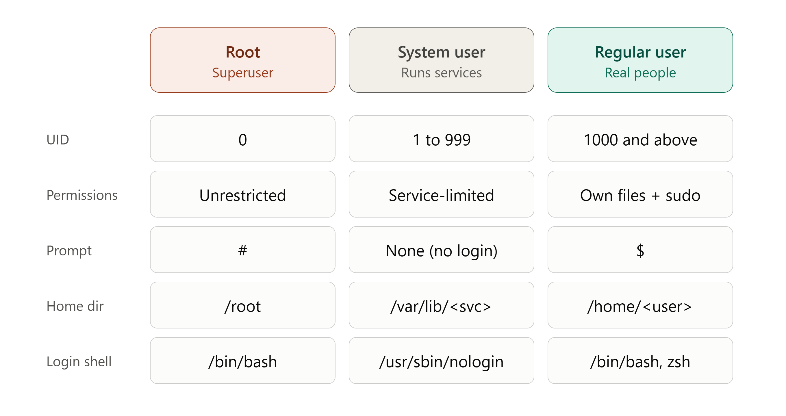
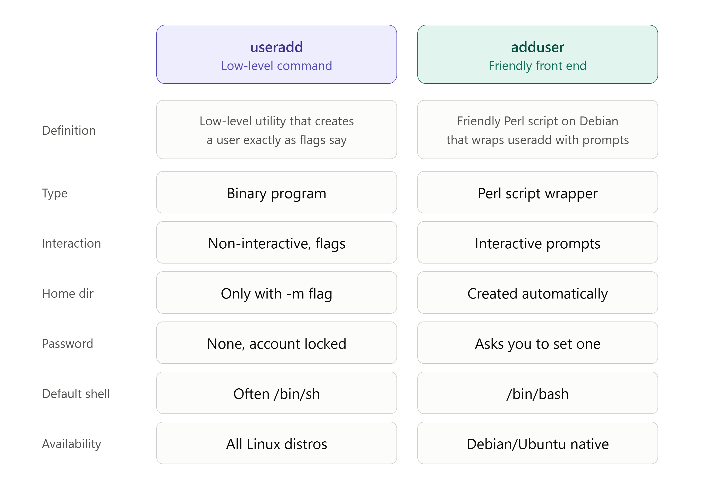

# Linux User Management

## Types of user:
- Local User
- Root User
- System User

### Some commands for user management
- `sudo -i` --> to switch to root user
- `id` --> to check id
- `useradd <username>` --> a low-level command that creates a user account exactly as the flags you give it, with no prompts
  
   - `useradd -m <username>` --> to create a user with its home directory

- `adduser <username>` --> a friendly Debian/Ubuntu script that wraps useradd and interactively sets up the home directory, group and password for you
- `su - <username>` --> to switch between users
- `exit / logout` --> logout
- `passwd <username>` --> to change or assign the password
- `sudo deluser <username>` --> remove the user but keeps the home directory
- `sudo deluser --remove-home <username>` --> remove the user and also the home directory

Difference between useradd and adduser:

## Files which get affected when we create any user:
- `tail -5 /etc/passwd` --> shows the last 5 user accounts 
                        -->readable by everyone
- `tail -5 /etc/shadow` --> shows the last 5 users' encrypted password hashes and password aging info
                      --> root only, so use `sudo`
- `tail -5 /etc/group` --> shows the last 5 groups (format: groupname:x:GID:members)
                       --> readable by everyone
- `tail -5 /etc/gshadow` --> shows the last 5 groups' secure data (group password, admins, members)
                         --> root only, so use `sudo`

Tail for last entries and head is for top entries

(format: name:x:UID:GID:comment:home:shell)

## Fields of `/etc/passwd`

kali:x:1002:1002:,,,:/home/kali:/bin/bash

- username --> kali
- linked to password --> x
- uid --> 1002
- gid --> 1002
- comment --> ,,,
- user's working dir --> /home/kali
- shell type --> bash

##### To change fields:
- username --> `-l`
- uid --> `-u`
- gid --> `-g`
- comment --> `-c`
- user's working dir --> `-m -d`
- shell type --> `-s`

command snippet : `usermod -flag "comments" <username>`

eg. `usermod -c "kali user made for practice" kali`

Dated: 26 October 2026
