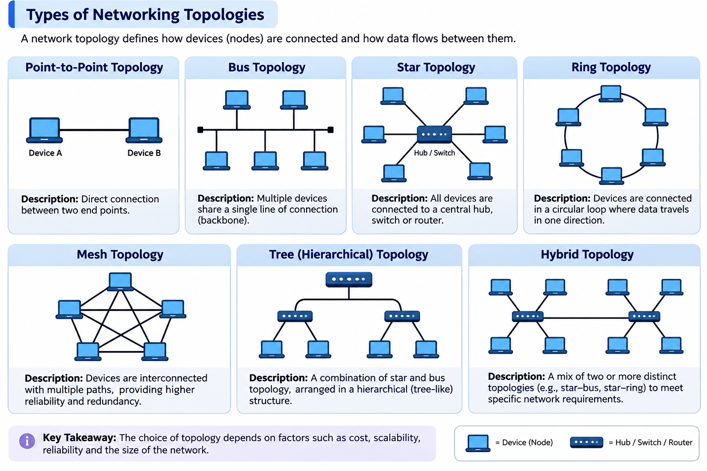

## 1. Networking

A **network** is a group of two or more devices connected to each other so they can communicate and share data or resources.

### 1.1 Types of Networks

| Type | Full Form | Meaning |
|---|---|---|
| `LAN` | Local Area Network | Connects devices within a limited geographical area, such as a home, office, or building |
| `WAN` | Wide Area Network | Connects networks over large geographical areas |
| `MAN` | Metropolitan Area Network | Connects devices or networks across a city or metropolitan area |
| `PAN` | Personal Area Network | Connects personal devices over a short range, such as a phone and wireless earbuds |

### 1.2 Types of Network Topologies

A **network topology** describes how devices are arranged and connected in a network.



---

## 2. Device Addresses

Devices use addresses to identify and communicate with one another on a network.

### 2.1 IP Address (Logical Address)

- An IP address is a logical address used to identify a device on an IP network.
- It can change depending on the network configuration.
- IPv4 uses **32 bits**.
- IPv6 uses **128 bits**.

### 2.2 MAC Address (Hardware Address)

- A MAC address identifies a network interface at the data-link layer.
- A standard MAC address is **48 bits** long.
- It is generally assigned to the network interface by its manufacturer, although it can sometimes be changed or overridden in software.

| Address | Type | Size | Purpose |
|---|---|---:|---|
| IP address | Logical address | IPv4: 32 bits; IPv6: 128 bits | Identifies a device/interface on an IP network |
| MAC address | Hardware/link-layer address | Commonly 48 bits | Identifies a network interface on a local network |

---

## 3. Common Networking Commands

| Command | Purpose |
|---|---|
| `ping` | Checks connectivity by sending packets to another host and receiving replies, when permitted |
| `ifconfig` | Displays or configures network interfaces on Linux (legacy; may not be installed by default) |
| `ip addr` | Displays IP addresses assigned to network interfaces on Linux |
| `ipconfig` | Displays network configuration on Windows |
| `nslookup` | Queries DNS to look up domain names and IP addresses |
| `dig` | Performs DNS queries and displays detailed DNS resolution information |
| `wget` | Downloads files from the web using supported protocols |
| `curl` | Transfers data to or from a server using supported protocols; commonly used for HTTP requests and downloads |

### 3.1 Examples

**Check network connectivity:**

```bash
ping google.com
```

**Check IP addresses on Linux:**

```bash
ip addr
```

**Check IP configuration on Windows:**

```powershell
ipconfig
```

**Look up a domain using DNS:**

```bash
nslookup google.com
```

**Query DNS records:**

```bash
dig google.com
```

**Download a file using `wget`:**

```bash
wget https://example.com/file.zip
```

**Transfer data or download a file using `curl`:**

```bash
curl https://example.com
curl -O https://example.com/file.zip
```

---

## 4. Cron Jobs

A **cron job** is a scheduled task that runs commands or scripts automatically at specified times or intervals.

### 4.1 Install Cron

On Debian/Ubuntu-based Linux distributions:

```bash
sudo apt install cron -y
```

- `apt` is the package manager.
- `install` installs the specified package.
- `cron` is the package name.
- `-y` automatically answers yes to package-manager confirmation prompts.

### 4.2 Manage the Cron Service

The `service` command and `systemctl` can be used to manage services.

**Using `service`:**

```bash
sudo service cron start
sudo service cron stop
sudo service cron status
```

**Using `systemctl` (modern service manager):**

```bash
sudo systemctl start cron
sudo systemctl stop cron
sudo systemctl restart cron
sudo systemctl status cron
sudo systemctl enable cron
```

| Command | Purpose |
|---|---|
| `systemctl start cron` | Starts the cron service |
| `systemctl stop cron` | Stops the cron service |
| `systemctl restart cron` | Restarts the cron service |
| `systemctl status cron` | Displays the service status |
| `systemctl enable cron` | Configures the service to start automatically at boot |

> On some Linux distributions, the service may have a different name (for example, `crond` instead of `cron`).

### 4.3 Crontab Commands

`crontab` is used to manage scheduled tasks for a user.

| Command | Purpose |
|---|---|
| `crontab -e` | Opens the user's crontab for editing |
| `crontab -l` | Lists the user's scheduled cron jobs |
| `crontab -r` | Removes all cron jobs belonging to the current user |

**Important:** Use `crontab -r` carefully. It removes all cron jobs for the current user and may not ask for confirmation.

### 4.4 Practise Cron Expressions

Use [crontab.guru](https://crontab.guru/) to understand and practise cron schedule expressions.

---

## 5. Quick Revision

| Topic | Command / Key point |
|---|---|
| Check connectivity | `ping google.com` |
| View IP addresses on Linux | `ip addr` |
| View network configuration on Windows | `ipconfig` |
| Query DNS | `nslookup domain.com` |
| Detailed DNS query | `dig domain.com` |
| Download a file | `wget URL` |
| Transfer data / download with curl | `curl URL` |
| Install cron | `sudo apt install cron -y` |
| Start cron service | `sudo systemctl start cron` |
| Check cron service status | `sudo systemctl status cron` |
| Edit scheduled tasks | `crontab -e` |
| List scheduled tasks | `crontab -l` |
| Remove all current user's scheduled tasks | `crontab -r` |

--- 

Dated : 5 November 2026